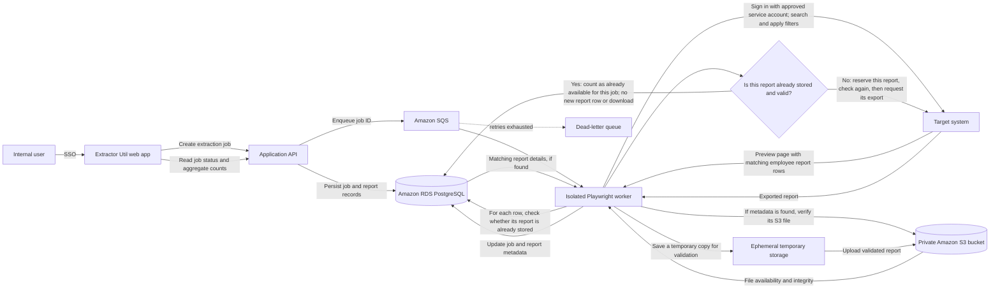
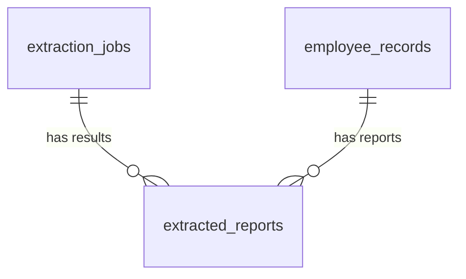

# Extractor Util

## Purpose

Extractor Util is an internal application for securely extracting employee reports from a target system. An authenticated user submits report criteria; an isolated background worker applies the criteria, retrieves matching reports, validates the exports, and stores them in a private Amazon S3 bucket.

PostgreSQL records job state and report metadata. Extractor Util exposes only overall job status and aggregate counts. It does not expose report contents, file links, or direct S3 access.

## User experience

1. The user signs in through the organization's approved application identity provider.
2. The user selects a tax year and report type supported by the target.
3. The application presents only the filters, lookups, sorting options, and selected fields supported by that report.
4. The user enters criteria and submits a search. Result-limit-only searches are rejected, and the maximum result limit is 500.
5. The user previews matching results and selects an export format offered by the target.
6. The application submits the validated request as an asynchronous job and displays:
   - Job status: queued, running, succeeded, partially succeeded, or failed.
   - Newly downloaded report count.
   - Already-available report count.
   - Failed report count.
7. Extractor Util does not provide report downloads or per-report file links. The target-system service account is used only by the worker.

### Filter and search behavior

- Load tax years, report types, lookup values, and export formats from the target where a stable target interface exists.
- Validate at least one usable search criterion before queueing a job.
- Apply report-specific filter definitions and do not submit unsupported fields.
- Preserve sorting and selected fields only when supported by the selected report.
- Display lookup selections through target-provided dialogs or equivalent accessible controls.
- Support pagination and record whether a search is truncated or reaches the configured limit.
- Mark a job `partially_succeeded` when all matching reports are not processed, rather than implying complete success.
- Treat the “reuse criteria” control as search settings for the current user’s next search only. It must not leak between users or jobs.
- Leave the compressed-file option disabled until its artifact format is defined: either as one archive or as unpacked individual reports.

## Proposed architecture

The recommendation is an AWS-hosted, asynchronous design because Amazon S3 is a stated storage requirement. Keep the existing Azure deployment as an alternative if organizational policy requires it; avoid splitting runtime, queue, and database across clouds without a clear requirement and ownership for cross-cloud identity, networking, monitoring, and cost.

### Application technology

The recommended AWS-native implementation uses the following stack. Keep the API and worker in the same repository if useful, but deploy them as separate containers so browser-job capacity can scale independently from request handling.

| Layer | Recommendation | Notes |
| --- | --- | --- |
| User interface | Next js, React, HTML, CSS, and JavaScript/Typescript | Keep the current lightweight approach for the initial workflow. Add a frontend framework only if the UI's complexity justifies it. |
| API | ASP.Net CORE web api or Node.js with TypeScript and Fastify | Provide authenticated job-creation and job-status endpoints. Validate request schemas and authorize access to each job. |
| Extraction worker | Node.js with TypeScript and Playwright | Run as a separate ECS/Fargate service. Reuse existing Playwright patterns while keeping browser sessions isolated and bounded. |
| Job queue | Amazon SQS with a dead-letter queue | Queue job identifiers, not credentials or report contents. Use the AWS SDK for JavaScript (`@aws-sdk/*`) and configure visibility timeout, retries, and redrive behavior for idempotent jobs. |
| Metadata database | Amazon RDS for PostgreSQL | Use the `pg` or a suitable ORM package and versioned SQL migrations; enforce state, uniqueness, and referential-integrity rules in the database. |
| Report storage | Private Amazon S3 with AWS KMS encryption | Use opaque object keys, block public access, and grant access only to backend task roles. |
| Runtime | Docker containers on Amazon ECS with AWS Fargate | Deploy the API and worker as separate services with distinct least-privilege task roles. |
| User identity and secrets | Organization-approved OIDC/SAML SSO; AWS Secrets Manager | Integrate the existing identity provider. Retrieve target credentials at runtime in the worker; never send them to the UI or store them in job records. |
| Monitoring | Amazon CloudWatch | Centralize redacted logs, metrics, and alerts for API, queue, worker, database, and storage health. |
| Infrastructure | Terraform | Provision environments, networking, IAM, compute, queue, database, and storage as code. |

Node.js and TypeScript will implement the API and extraction worker. Use the Node.js test runner or `vitest` for unit and integration tests, and retain Playwright for browser-level end-to-end coverage. The current Node.js prototype is not a durable production backend and should not be extended with premature queue or cloud dependencies.

### Infrastructure requirements

- Separate development, test, and production resources and data.
- Deploy the API and worker as separate ECS/Fargate services with separate task roles.
- Place workers and PostgreSQL in private subnets. Restrict public entry points to the application API and UI.
- Permit worker egress only to approved target-system endpoints and required AWS services.
- Use SQS for asynchronous delivery, with bounded retries, a visibility timeout aligned to maximum job duration, and a dead-letter queue.
- Encrypt PostgreSQL and S3 resources; keep databases private and configure backups and point-in-time recovery.
- Use CloudWatch for redacted application and infrastructure logs, metrics, and alerts.
- Document deployment, rollback, backup restoration, secret rotation, and incident procedures.
- Confirm the approved AWS region, network standards, target IP allowlisting, managed PostgreSQL service, and application identity provider before implementation.

## Job and worker behavior

1. Authenticate the requester and authorize the requested report scope.
2. Validate the tax year, report type, filters, required entries, result limit, and export format. Return actionable validation errors.
3. Create the queued job and audit metadata in one database transaction. Enqueue the job ID separately and explicitly handle enqueue failure.
4. Claim the job in a worker, mark it running, and open an isolated browser context. Retrieve the target service-account secret at runtime; never expose or persist it in job records.
5. Navigate the target, apply the validated criteria, and collect preview rows up to the configured limit.
6. For each row:
   - Build an opaque matching identifier from the employee record, tax year, report type, export format, and content-affecting options.
   - Look up a successful, in-date matching report and verify the S3 object against its recorded metadata.
   - If valid, count the report as already available for this job. Do not insert another `extracted_reports` row or create another S3 object.
   - Otherwise, acquire a database reservation for the matching identifier and recheck it before export.
   - If still unavailable, select the row and capture the target export in ephemeral worker storage.
   - Validate the file signature and non-zero size, calculate a checksum, upload it to S3, and persist the report metadata.
7. Calculate the job outcome:
   - `succeeded`: all processed reports completed successfully.
   - `partially_succeeded`: the target limit was reached, results were truncated, or some reports failed.
   - `failed`: no reports could be processed or the worker cannot continue.
   - `cancelled`: execution stopped by cancellation or an operator.
   - A valid search with no matches completes successfully with zero reports.
8. Retry only bounded, transient failures. Do not retry invalid input, unsupported combinations, authorization failures, or deterministic target errors. Route exhausted retries to the dead-letter queue.

Apply explicit timeouts and clean temporary files after success or failure. Do not log report contents, passwords, NI numbers, or unredacted target pages.

### Concurrency and capacity controls

- Define the worker pool's minimum, desired, and maximum task counts in the deployment configuration or infrastructure-as-code. For ECS/Fargate, these are the ECS service's task counts; use queue depth and message age to guide autoscaling within the configured maximum.
- Configure the maximum number of active jobs per worker task separately. Start with one browser job per task to keep browser sessions isolated, then increase only if load testing confirms resource and target-system limits allow it.
- Enforce a pool-wide cap on simultaneous target sessions. A per-task limit alone is insufficient when the service scales out; use the pool maximum or a shared concurrency limiter, especially if the target restricts concurrent sessions for the service account.
- Set queue visibility timeout, retry count, and dead-letter behavior to match the job's maximum processing time. Also bound database connections, browser/download timeouts, and job submissions so scaling workers does not overwhelm dependent systems.
- Keep non-secret limits and timeouts in deployment configuration, with secrets in the managed secret store. Record approved values and scaling signals in the operational runbook. Establish the initial limits through target-approved load testing rather than assuming the target can handle unrestricted parallelism.

## Data model

PostgreSQL is the source of truth for job state, employee records, and report metadata. S3 is the source of truth for report bytes.

Each `extracted_reports` row references exactly one job and one employee record. A job or employee record can have zero or more report rows. If a valid matching report already exists from an earlier job, no new report row is created; only the current job's `already_available_reports` count is updated.

### `extraction_jobs`

Stores each submitted extraction request and its lifecycle, criteria, and aggregate outcome. Create the row when the job is queued, update it as processing progresses, and finalize its status and report counts when processing ends.

- `id` UUID primary key
- `requested_by` authenticated application user ID
- `status` (`queued`, `running`, `succeeded`, `partially_succeeded`, `failed`, `cancelled`)
- `tax_year`, `report_type`, `export_format`
- `criteria` JSONB containing only fields needed to reproduce/audit the request; restrict access and retention
- `result_limit`, `total_reports`, `downloaded_reports`, `already_available_reports`, `failed_reports`
- `created_at`, `started_at`, `completed_at`
- Safe, non-sensitive failure code/message; do not store secrets or raw page content

### `employee_records`

Stores one employee record with the filterable employee attributes used by the new system. Each report references this shared record and its extraction job rather than duplicating employee attributes for every report.

- `id` UUID primary key
- Filterable employee attributes supported by the target, such as employee number, group, NI number, surname, job name, and job number; treat these as sensitive personal data and restrict access
- `created_at`

The UUID is an internal identifier; no target-system record identifier is required. Define how employees are recognized across extraction jobs to prevent duplicate employee rows. Use the employee number as that business identifier only if it is confirmed to be unique and stable in the new system. Employee attributes are treated as immutable after the record is first extracted. If a later extraction returns conflicting attributes for the same employee, handle it through an explicit correction process rather than silently overwriting the record. Add indexes for the supported filter patterns; do not index or expose raw NI numbers unnecessarily.

### `extracted_reports`

Stores report records for downloads and failed attempts associated with a job. If a matching valid report already exists from an earlier job, do not add another row; count it as already available on the current job instead.

- `id` UUID primary key; `job_id` and `employee_record_id` foreign keys
- `tax_year`, `report_type`, `export_format`
- `status` (such as `downloaded` or `failed`), `attempt_count`, safe `original_filename`, MIME type, byte size, SHA-256 checksum
- `s3_bucket`, opaque `s3_object_key`; never put employee names, NI numbers, or other direct identifiers in object keys
- Opaque report-matching identifier used to find a valid report from an earlier job
- `created_at`, `stored_at`, `completed_at`, safe failure code/message
- Unique constraints to prevent duplicate report rows for the same employee record, tax year, report type, and content-affecting options within a job

The new employee records system can filter reports by joining `extracted_reports` to `employee_records`. The matching identifier must include the stable employee identity selected for the new system, tax year, report type, export format, and all other report options that affect content; employee number alone is insufficient because report options also affect content. A report may be reused only while its metadata is successful, its S3 object is present and valid, and it remains within the configured freshness period. Job-level aggregate counts must be updated idempotently so a retry does not count the same report more than once. Database migrations and constraints must enforce valid states and relationships.

PostgreSQL must not store report contents. Retention, access, and deletion policies for personal metadata and S3 objects must be defined before production.

## Storage and privacy requirements

- Store reports in a private S3 bucket with public access blocked, TLS-only access, encryption at rest, and access logging.
- Use least-privilege task roles and opaque keys such as `reports/{tax-year}/{report-type}/{report-id}.{extension}`.
- Preserve the target export as-is. Do not transform it or silently substitute another format.
- Use idempotent object keys for retries. A rerun may reference an existing, current object but must not create or copy another object.
- Never expose bucket credentials or object URLs. The application has no report-download endpoint or links.
- Store target credentials in a managed secret store and grant access only to the worker. Record which application user requested the job even though the target login uses a service account.
- Apply lifecycle expiration consistently to S3 objects, PostgreSQL metadata, and backups. Do not delete an object while retained report records reference it.
- Confirm the service account's approved report scope and target-system terms. MFA, CAPTCHA, IP restrictions, session expiry, password rotation, and stable unattended authentication are discovery gates. Do not bypass controls; use an approved API or target-approved authentication flow where browser automation is not permitted.

## Implementation plan

1. **Resolve discovery gates.** Confirm the hosting/cloud decision, approved AWS region, PostgreSQL service, application SSO provider, data retention, how long a stored report is considered current, rerun policies, target service-account permissions, and whether the target offers an approved API or stable unattended browser login. Verify export formats and exact filter/lookup behavior for the supported report types.
2. **Prove the target workflow safely.** In a non-production environment or with approved test data, automate login, year/report selection, required-entry selection, filtering, result pagination, row selection, export, and download for representative report types. Measure authentication stability and a 500-report run before choosing worker concurrency/timeouts.
3. **Implement durable backend.** Add authenticated job/report APIs, PostgreSQL migrations, queueing, isolated Playwright workers, secret retrieval, S3 upload, idempotency, bounded retries, and dead-letter handling.
4. **Extend the UI.** Replace the single generic filter with tax-year/report selection and report-specific accessible filters/lookups. Add export-format selection, validation, and an overall job status with aggregate counts for downloaded, already available, and failed reports. Do not show per-report details or file links.
5. **Harden and release.** Add monitoring/alerts, audit events, retention lifecycle, backup/deletion procedures, operational runbooks, least-privilege policies, and production acceptance tests. Deploy only after authorization, privacy, and target automation gates are approved.

## Acceptance criteria

- Users must authenticate to the application using the organization's approved authentication.
- A requester can submit a valid job using a target-supported report type, tax year, filters, required entries, and export format.
- Invalid or empty search criteria and limits above 500 are rejected before a job is queued.
- The UI shows the overall job status and accurate aggregate counts for newly downloaded, already available, and failed reports; it does not show per-report details or file links.
- If target results are truncated or a result limit is reached, the overall job status does not imply that all matching reports were retrieved.
- A successful report is validated, stored in private S3, and has matching PostgreSQL metadata including object key, checksum, format, and status. A later matching job counts it as already available without inserting another `extracted_reports` row, exporting, downloading, or creating a second S3 object when the metadata is successful, the object is present and valid, and the report is still considered current.
- Concurrent matching jobs do not cause duplicate target downloads; a job that finds another job processing the same report waits or checks again, then counts it as already available without inserting another report row.
- Retrying a job does not count the same report more than once in its aggregate counts.
- Retrying a transient failure does not create duplicate report rows or duplicate objects. Deterministic errors do not loop through retries.
- A user cannot view another user's job status or counts unless explicitly authorized. Extractor Util does not expose report files, object URLs, or bucket credentials.
- Logs and error responses contain no passwords, NI numbers, report contents, or unnecessary employee data.
- Worker temporary files are removed after processing, and object/metadata deletion follows the approved retention policy.
