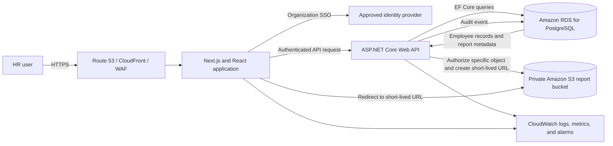
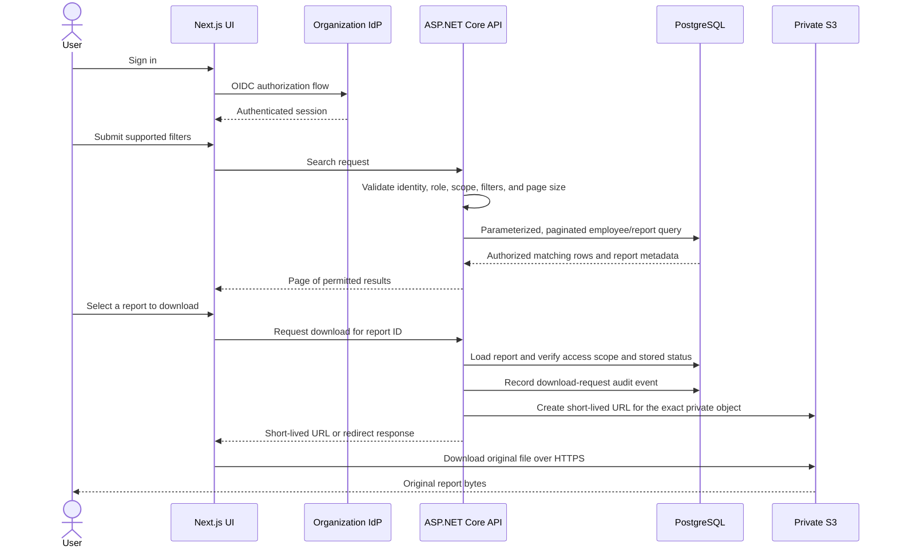
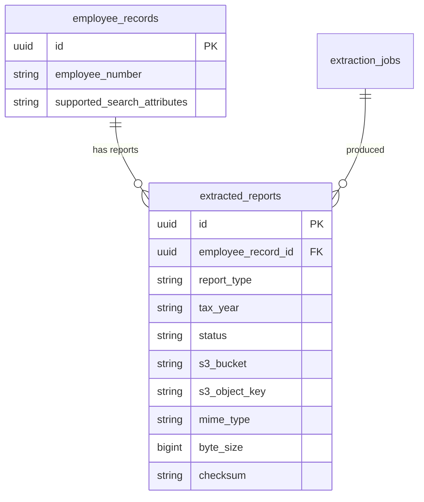

# New HR Select Solution Design

## 1. Purpose

Design a replacement HR Select application that lets authorized users search already-extracted employee records using supported filters and download the associated stored report files.

The new system is a read/search and download application. It does not automate the target system, re-extract employee records, or copy report files into a second store. It uses the existing PostgreSQL records and private Amazon S3 report objects described by the Extractor Util design.

## 2. Goals and scope

### Goals

- Provide a familiar HR Select experience for searching extracted employee records.
- Support approved filters with predictable pagination and sorting.
- Show only records and report metadata the signed-in user is authorized to access.
- Allow an authorized user to download the original stored report associated with a matching record.
- Preserve the source file without transforming it.
- Audit searches and download requests without logging unnecessary employee data or file contents.
- Use Next.js and React for the UI, ASP.NET Core Web API for application services, EF Core for PostgreSQL access, and PostgreSQL as the metadata store.

### Out of scope

- Target-system login, scraping, or extraction.
- Modifying or regenerating stored report files.
- Replacing the existing extraction worker or its data-ingestion process.
- Direct client access to PostgreSQL, S3 credentials, or unrestricted object listings.
- Bulk archive generation until archive format, limits, and retention are approved.

## 3. Assumptions and decisions

| Topic | Design assumption | Status |
| --- | --- | --- |
| Data source | Employee records and report metadata already exist in the current PostgreSQL database; report bytes are in the existing private S3 bucket. | Confirm exact schema, ownership, and environment access before implementation. |
| Hosting | Deploy the UI and API on AWS. Use managed AWS services where practical. | AWS selected; region and organization standards remain to be confirmed. |
| Identity | Organization SSO is required. The API authorizes access based on authenticated identity and assigned roles/scopes. | Provider, claims, provisioning, and exact role rules are open. |
| Downloads | Users download original stored report files matching their search. | Individual-download flow is specified below. |
| Bulk download | ZIP/batch downloads are not included in the initial scope. | Confirm whether users need bulk downloads and define limits before adding them. |
| File delivery | The API authorizes each download and returns a short-lived URL for the specific S3 object. | Confirm security policy permits short-lived bearer URLs; API streaming is the alternative. |
| Data ownership | The extraction system remains the owner of employee and extracted-report data. The new app reads those tables and writes only its own audit/application records. | Confirm with database owners. |

## 4. Proposed architecture



### Request and download flow



## 5. Component responsibilities

| Component | Responsibility |
| --- | --- |
| Next.js / React UI | Render accessible filter controls, search results, pagination, report details, and download actions. Do not embed credentials or access S3 directly with AWS credentials. |
| Next.js server-side session/BFF | Recommended boundary for the browser session. Keep session credentials in secure, HttpOnly, SameSite cookies and call the API server-to-server. Do not store access tokens in browser local storage. |
| ASP.NET Core Web API | Validate authentication and authorization, validate and normalize filters, query the existing data, provide paginated result DTOs, authorize download requests, issue short-lived object URLs, and record audit events. |
| EF Core | Map the existing PostgreSQL schema. Use parameterized LINQ queries, projections, and explicit pagination. Avoid returning tracked entities or database entities directly from API endpoints. |
| Amazon RDS for PostgreSQL | Continue to hold employee records and extracted-report metadata. Host new application-owned audit tables separately or in an agreed schema. |
| Amazon S3 | Continue to hold original report bytes in a private bucket. Permit access only through backend workload identity and narrowly scoped object operations. |
| AWS edge and runtime | Route HTTPS traffic, apply WAF protections, host the UI/API, and provide private connectivity to RDS and S3. |
| CloudWatch | Collect structured, redacted logs, service metrics, dashboards, and actionable alarms. |

Keep the UI and API as independently deployable services. They may share a repository, but should have separate runtime identities, deployment settings, health checks, and scaling controls.

## 6. User experience

1. The user signs in through organization SSO.
2. The application loads the filters, lookup values, and report types available to that user.
3. The user submits one or more supported filters. The UI clearly indicates required filters and validation errors.
4. The API returns a paginated result list containing only the employee fields and report metadata needed for the screen.
5. The user selects an available report and requests its download.
6. The API checks the user's authorization again for that specific report, records the request, and returns a short-lived download URL.
7. The browser downloads the original file. The application does not expose S3 credentials or a permanent public URL.
8. Empty results, unavailable files, expired links, and authorization failures are reported explicitly and accessibly.

### Search and result behavior

- Define an allow-list of supported filter fields and operators. Do not accept arbitrary column names, SQL fragments, or sort expressions from the client.
- Require at least one approved criterion that sufficiently narrows a search, based on HR data-owner policy.
- Set a server-enforced maximum page size. Use stable ordering and a unique tie-breaker to avoid duplicate or missing rows between pages.
- Return only the fields needed by the UI. Mask or omit sensitive identifiers unless the user's role and business need require them.
- Avoid broad, unbounded searches and include rate/abuse controls appropriate to the internal application.
- Apply the user's authorization scope to the database query, not only to UI controls.
- Distinguish records with no available report from reports that are pending, failed, expired, or missing in storage.
- Do not imply that a partial result page is the complete match set; provide pagination and total counts only when their cost and privacy impact are acceptable.

## 7. API design

Use versioned JSON endpoints under `/api/v1`. The exact filter schema should be based on approved HR search fields and database indexes.

| Method and route | Purpose |
| --- | --- |
| `GET /api/v1/me` | Return the authenticated user's application identity and effective permissions needed by the UI. |
| `GET /api/v1/lookups` | Return the filter lookup values the current user is allowed to use. |
| `POST /api/v1/employee-records/search` | Validate filters and return a bounded, paginated list of matching employee records and available report summaries. |
| `POST /api/v1/reports/{reportId}/download` | Re-check authorization and report status, write an audit event, and return a short-lived download URL or redirect. |

Example search request (illustrative only; final fields depend on the existing schema):

```json
{
  "filters": {
    "employeeNumber": "EMP-1042",
    "taxYear": 2025,
    "reportType": "payslip"
  },
  "pageSize": 25,
  "continuationToken": null
}
```

API requirements:

- Use request/response DTOs rather than serializing EF entities.
- Validate all fields, allowed operators, lengths, page sizes, and continuation tokens on the server.
- Apply authorization scopes in every query and download operation.
- Return consistent problem details with safe, actionable messages and a correlation ID.
- Do not include SQL errors, object keys, credentials, or unnecessary personal data in error responses.
- Use idempotent semantics for audit/download-request creation where retries can otherwise create misleading duplicate events.
- Add API rate limits and request timeouts; do not hold a database transaction open while a user downloads a file.

## 8. Data and persistence

### Existing data

Use the existing employee and extracted-report tables as the source for searches. The expected logical relationships are:



The diagram is conceptual. Confirm the actual table names, columns, keys, status values, and database ownership before implementing EF Core mappings. The API must treat database values as untrusted input and must not expose internal storage details to clients.

### New application-owned data

Add a minimal audit table in an application-owned schema. Example fields:

- `id` UUID primary key
- `actor_id` stable SSO subject identifier
- `action` such as `search` or `download_requested`
- `resource_id` for a report or job where applicable
- `occurred_at` timestamp
- `correlation_id`
- Safe outcome code
- Optional minimal filter metadata only where approved for audit and retention

Do not store raw report contents, passwords, bearer tokens, presigned URLs, or unnecessary sensitive filter values in audit records. Define retention and access controls for audit records with the data owner.

### EF Core and schema ownership

- Use EF Core read-only mappings for tables owned by the extraction system. Do not let application startup migrations modify those tables.
- Use explicit projections and `AsNoTracking()` for search paths.
- Use migrations only for tables/schemas owned by the new application, with a deployment identity restricted to those objects.
- Confirm foreign keys and indexes exist for approved filter patterns and employee-to-report joins. Add changes through the database owner's migration process.
- Configure connection pooling, command timeouts, and bounded connection counts.
- Use database transactions for application-owned audit writes when needed, but avoid long-running transactions during S3 operations.

## 9. Authentication, authorization, and privacy

- Integrate the organization-approved OIDC/SAML provider; use OIDC for the web/API flow if supported.
- Prefer a Next.js server-side session/BFF so browser tokens are not stored in local storage. Use `Secure`, `HttpOnly`, and appropriate `SameSite` cookie settings, CSRF defenses for state-changing requests, and session expiry.
- Validate token issuer, audience, signature, expiration, and required claims in the API.
- Define roles and data scopes with HR/data owners. Example role names may include `HRReader` and `HRAdministrator`, but names and permissions are not approved until confirmed.
- Enforce least privilege at the API and data-access layers. A user must not retrieve another department's records by changing request parameters or report IDs.
- Re-authorize every download independently of the earlier search result.
- Restrict database credentials to required schemas and operations. Restrict the API workload's S3 role to the existing report bucket and required object reads.
- Encrypt traffic in transit and storage at rest using approved AWS encryption/key-management policies.
- Redact employee identifiers, query values, object keys, tokens, cookies, and presigned URLs from logs.
- Apply an approved retention policy to audit events and application logs. Do not retain search criteria longer than necessary.
- Document access reviews, account deprovisioning, incident response, and data-subject/privacy handling.

## 10. Secure file-download design

1. The client submits an opaque report ID, not an S3 key.
2. The API loads the report metadata and verifies that the report is available and belongs to a record within the user's authorized scope.
3. The API verifies that the bucket and object key are from trusted database records and are within the configured bucket/prefix. Do not accept arbitrary storage locations from the client.
4. The API writes a download-request audit event, subject to the agreed audit policy.
5. The API creates a short-lived, HTTPS-only presigned URL for that one object, using a backend workload identity. Use a short expiry (for example, a few minutes) and an attachment content disposition with a sanitized filename.
6. The UI initiates the download and does not persist or log the URL. The URL is a bearer credential until it expires; prevent it from entering application logs, analytics, browser history where practical, and referrer headers.
7. S3 remains private, blocks public access, and does not grant users bucket listing or general object access.

If policy prohibits presigned URLs, stream the object through an authenticated API endpoint instead. This increases API bandwidth and connection duration, so size limits, cancellation, timeouts, and capacity must be designed and load-tested.

Treat missing S3 objects or metadata mismatches as explicit operational errors. Do not return a success-shaped response or expose storage internals to the user.

## 11. AWS deployment

Proposed deployment, subject to organization standards:

- **Edge:** Route 53, CloudFront, and AWS WAF for public HTTPS ingress. Restrict API ingress to the approved application path and network policy.
- **UI:** Next.js container on Amazon ECS with AWS Fargate, or an approved managed Next.js hosting service. Select one runtime after confirming organization support for server-side rendering and session handling.
- **API:** ASP.NET Core container on ECS/Fargate behind an Application Load Balancer. Keep the service in private subnets where possible.
- **Database:** Existing Amazon RDS for PostgreSQL, reachable only from authorized application subnets/security groups. Do not create a second database unless required by ownership or isolation policy.
- **Files:** Existing private S3 bucket. Use task roles, server-side encryption, TLS-only access, block public access, and bucket policies that deny unintended access.
- **Identity/secrets:** Use the approved identity provider and AWS Secrets Manager or an equivalent managed service for database secrets and signing/configuration secrets. Prefer workload identity over long-lived AWS keys.
- **Observability:** CloudWatch logs, metrics, dashboards, and alarms. Use distributed trace/correlation identifiers across UI/API/database operations without attaching sensitive data.
- **Infrastructure as code:** Provision and update AWS resources through the organization's approved IaC workflow.
- **Environments:** Separate development, test, and production configuration and data. Use synthetic or approved masked data outside production.

Keep RDS and application services in private networking where feasible. Restrict outbound access, database ingress, S3 access, and deployment permissions to documented requirements.

## 12. Reliability and operational behavior

- Use health/readiness endpoints that verify application dependencies without exposing sensitive details.
- Apply bounded retries only to transient database/network errors. Do not retry validation, authentication, authorization, or missing-object errors indiscriminately.
- Configure cancellation and timeouts for search and download-request operations.
- Monitor API latency/error rates, database connection saturation, denied requests, download-request outcomes, S3 errors, and authentication failures.
- Alert on unusual download volume, repeated authorization denials, elevated missing-object rates, and service unavailability.
- Use structured logs with correlation IDs and safe error codes. Never log file bytes or presigned URLs.
- Define backup, restoration, and disaster-recovery responsibilities with the owners of the existing PostgreSQL database and S3 bucket.
- Document rollback and release procedures. Deploy schema changes backward-compatibly.

## 13. Testing and acceptance criteria

### Testing

- Unit tests for filter validation, role/scope evaluation, DTO mapping, and safe filename generation.
- API integration tests against PostgreSQL for joins, pagination stability, authorization scoping, and unavailable-report states.
- S3 integration tests using a non-production bucket to verify the API can authorize and create a narrowly scoped, short-lived URL without public access.
- UI accessibility tests for labels, keyboard navigation, focus visibility, error messages, and screen-reader status updates.
- End-to-end tests for sign-in flow, filtered search, pagination, authorized download, and denied cross-scope access.
- Performance/load tests using approved synthetic or masked data for representative filter combinations and concurrent users.
- Security tests for CSRF/session protections, token validation, object-ID tampering, filter injection attempts, rate limiting, and sensitive-data redaction.

### Acceptance criteria

- An SSO-authenticated user can search using supported filters and receives only records within their authorized scope.
- Empty, malformed, unsupported, or excessively broad requests are rejected with safe validation messages.
- Search results are paginated, consistently ordered, and contain no unapproved employee attributes or storage details.
- A user can download an original file only after the API verifies access to that specific report.
- The bucket remains private; no S3 credentials or permanent public URLs are exposed to the browser.
- Short-lived download links are not written to logs or persistent application state.
- Missing, failed, or expired report objects are reported clearly and safely, and trigger observable operational signals.
- Audit events identify the actor, action, resource, time, and correlation ID without storing report contents or secrets.
- Application database migrations do not alter extraction-system-owned tables.
- Operational dashboards, alerts, retention, backup/restore, and deployment rollback procedures are documented and tested.

## 14. Delivery plan

1. **Discovery:** Confirm the existing schema, S3 object conventions, report statuses, target filter behavior to reproduce, identity provider, role/scope rules, data classification, retention, and hosting standards.
2. **Data access proof:** Map the existing tables with EF Core in read-only mode; validate representative queries, indexes, pagination, and object metadata without changing extraction-owned schema.
3. **Foundation:** Provision environment-specific UI/API hosting, identity integration, database connectivity, workload roles, logging, and health checks.
4. **Search experience:** Implement accessible filter forms, lookups, validated search endpoints, result summaries, authorization scopes, and pagination.
5. **Download experience:** Implement per-report authorization, audit logging, short-lived object delivery, error handling, and privacy-safe logging.
6. **Hardening and rollout:** Complete automated tests, security/privacy review, performance checks, operational runbooks, pilot with approved users, and staged production rollout.

## 15. Open decisions before implementation

1. What identity provider and claims/groups should the system use, and how are users provisioned and deprovisioned?
2. Which roles exist, and what row-level scopes apply (for example, all employees, organization, department, or assigned population)?
3. What are the exact existing PostgreSQL table/column names and ownership boundaries? Can the application use a read-only DB role for extraction-owned data?
4. Which employee fields, report types, filter operators, lookups, sorting options, and page sizes should the replacement support?
5. Should a search return employee records, report records, or a grouped employee view with one or more associated reports?
6. Do users need bulk downloads? If so, define archive format, maximum record/file count, maximum total size, asynchronous job behavior, archive retention, and audit requirements.
7. Are short-lived S3 presigned URLs permitted, or must all file bytes pass through the API?
8. What download filename, MIME-type, file-integrity, and unavailable-object behavior is required?
9. Which AWS region, edge/runtime platform, network controls, key-management policy, and infrastructure-as-code standard are mandated?
10. What are the retention periods for employee metadata, audit events, application logs, and the original report files?
