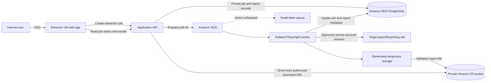

# Extractor Util — Target integration specification

## Purpose and current boundary

Extend the POC from its sample payslip page into an internal report-extraction application. An authorized user selects target-system criteria; a background worker uses the approved service account to retrieve matching reports, stores the report files in private Amazon S3, and records job and report metadata in PostgreSQL.

The current application is a demonstration only: report data is hard-coded, and the login form accepts any values and only redirects. It does not authenticate users or connect to the target payroll system, S3, PostgreSQL, or a queue. The Azure deployment script and the earlier Azure architecture are not production-ready integrations.

## Target-system user flow

1. The user signs in to Extractor Util using the organization's application authentication. The target-system service-account login is separate and runs in the worker.
2. The user selects a tax year from the years offered by the target.
3. The user selects a report type. The screenshots show Gross To Nett, Import - Absence, Import - Absence (Retro), Leaves with O/S Loans - Retail, Loans, Messages (A/B/C), P45s, P60, Payslips, Payslips - Retail, Pension / AVC, Statement of Earnings P45 - Retail, Statement of Earnings P60, TC02, and Voluntary Deductions. The initial release should support P60 and Payslips; keep report-specific behavior extensible.
4. The application displays filters supported by the selected report. The P60 example includes Employee Number, Group, NI Number, Surname, Job Name, Job Number, result limit, sorting, reuse-criteria, and selected fields. Group and Job Name may require a target-provided lookup/selection dialog. The result limit defaults to 50 and is capped at 500.
5. After search, the target returns matching records. The user can select a result to preview it, then choose an export format offered by the target. The screenshots show Word document, Word document (with the text overlay), Text file (no page breaks), Text file (with page breaks), Text file (with page breaks and text overlay), PDF document, and PDF document (with an image overlay), plus a compressed-file option. Do not assume every format is available for every report type; use the target's available options and an explicit allowlist.
6. Extractor Util runs the extraction asynchronously and presents per-report progress and final outcomes.
7. The worker captures the selected export through Playwright's download handling, validates it, and uploads it to S3. It does not open a desktop “Save as” dialog. The user can later download a stored report through an authorized application action.

### Filter and result behavior

- Load tax years, report types, lookup entries, and export formats from the target where possible; avoid hard-coding changing lists.
- Validate that at least one usable search criterion is present before starting a job. Do not accept a result-limit-only search. Enforce the configured maximum of 500 returned reports per job.
- Use report-specific filter definitions so unsupported fields are not submitted. Preserve sort direction and selected fields only where the target supports them.
- Treat result rows as report candidates. A report is not complete until the target's export action produces a file and that file is validated and stored.
- Initially leave the compressed-file option off unless it is required. If enabled later, define whether the archive is stored as one artifact or safely unpacked into individual reports before implementing it.
- Support pagination and count limits explicitly. Show when the target indicates results were truncated or the limit was reached; do not silently claim all matching reports were retrieved.
- The “reuse criteria” control affects the user's next search only; it must not cause criteria to leak between users or jobs.

## Proposed architecture

The recommendation is an AWS-hosted, asynchronous design because Amazon S3 is a stated storage requirement. Keep the existing Azure deployment as an alternative if organizational policy requires it; avoid splitting runtime, queue, and database across clouds without a clear requirement and ownership for cross-cloud identity, networking, monitoring, and cost.

### Hosting alternatives

| Option | Description | Considerations |
| --- | --- | --- |
| Recommended: AWS-native | Host the API and Playwright workers as containers (for example, ECS/Fargate); use SQS, RDS for PostgreSQL, S3, Secrets Manager, KMS, and CloudWatch. | Keeps the required file store and application runtime in one cloud. Confirm the organization's AWS hosting, network, and identity standards. |
| Azure hybrid | Retain Azure hosting and queueing, use the approved PostgreSQL service, and upload to Amazon S3. | Requires an approved Azure-to-AWS workload identity and network design; avoid long-lived AWS access keys. Adds cross-cloud operational and egress considerations. |

Do not treat the current Azure App Service script as a complete design for running concurrent, durable browser jobs. Select the hosting option and managed PostgreSQL service before implementation.

## Job and worker behavior

1. Authenticate the requester and authorize the requested report scope.
2. Validate report type, tax year, supported filters, required entries, result limit, and export format. Reject invalid requests with actionable errors.
3. In one database transaction, create a queued job and its request/audit metadata. Enqueue its ID; handle enqueue failure explicitly so the job cannot remain falsely queued.
4. A worker claims the job, marks it running, and opens an isolated browser context. Retrieve the service-account secret at runtime from a secrets manager; never send it to the UI or persist it in job records.
5. Navigate the target's tax-year and report selection flow, apply the validated filters, select required entries, and collect result rows within the configured cap.
6. For each result, derive a cache identity from the employee number, tax year, report type, export format, and any report-specific options that affect the exported content. Before invoking the export, look up a previously successful report with that identity in PostgreSQL and verify that its S3 object exists and matches the recorded metadata. If it does, reuse that object and skip the target export and download. Otherwise, claim the cache identity so concurrent jobs do not both download the same report; after acquiring the claim, recheck the metadata and S3 object before proceeding. On a cache miss, select the row, invoke the requested export, capture the browser download to ephemeral worker storage, validate file type/signature and non-zero size, calculate a checksum, and upload to S3.
7. Persist each report's status and metadata, then calculate the job's final status: `succeeded`, `partially_succeeded`, or `failed`. A reused report is a successful outcome for the new job and points to the existing S3 object; preserve the artifact's original `stored_at` and record that it was reused. A no-match result is a completed job with zero reports, not a worker error.
8. Retry only transient failures with bounded exponential backoff. Do not retry invalid filters, unsupported report/format combinations, authorization failures, or other deterministic errors. Make retries idempotent and route exhausted jobs to a dead-letter queue for operator review.
9. Expose status and per-report outcomes to the requester. Provide access to files only after application authorization; use short-lived presigned URLs or a server-mediated download.

Use explicit timeouts, worker concurrency limits, job cancellation where feasible, and cleanup of temporary files on both success and failure. Do not log report contents, passwords, NI numbers, or unredacted target pages.

## Data model

Use PostgreSQL as the source of truth for job state and report metadata; S3 is the source of truth for report bytes.

### `extraction_jobs`

- `id` UUID primary key
- `requested_by` authenticated application user ID
- `status` (`queued`, `running`, `succeeded`, `partially_succeeded`, `failed`, `cancelled`)
- `tax_year`, `report_type`, `export_format`
- `criteria` JSONB containing only fields needed to reproduce/audit the request; restrict access and retention
- `result_limit`, `total_reports`, `stored_reports`, `failed_reports`
- `created_at`, `started_at`, `completed_at`
- Safe, non-sensitive failure code/message; do not store secrets or raw page content

### `extracted_reports`

- `id` UUID primary key; `job_id` foreign key
- Target record identifier and only the employee/report attributes needed for audit and retrieval; treat these as sensitive personal data
- `status` (including whether the report was newly downloaded or reused), `attempt_count`, `export_format`, safe `original_filename`, MIME type, byte size, SHA-256 checksum
- `s3_bucket`, opaque `s3_object_key`; never put employee names, NI numbers, or other direct identifiers in object keys
- Opaque cache identity and, for a reused report, a reference to the metadata row from which it was reused
- `created_at`, `stored_at`, `completed_at`, safe failure code/message
- Unique constraints to prevent duplicate report rows for the same target record within a job

Use the employee number together with tax year, report type, export format, and any content-affecting report options to identify a reusable report; employee number alone is not sufficient. Store the cache identity in an opaque form and keep it out of S3 object keys. Reuse only successful metadata whose object is present in S3 and passes integrity checks. If the object is missing or invalid, treat it as a cache miss and download it again. Serialize cache misses with a database-backed claim or lease keyed by cache identity, and recheck after acquiring the claim, so simultaneous jobs can reuse the first successful result instead of downloading it twice. Define an approved freshness/expiration policy for reports that may change at the target.

Use migrations and database constraints for valid states and relationships. Store no report contents in PostgreSQL. Minimize personal metadata, restrict database access, and define an explicit retention/deletion policy for both metadata and S3 objects before production.

## S3, access, and privacy requirements

- Use a private bucket with public access blocked, encryption at rest (prefer a customer-managed KMS key where required), TLS in transit, least-privilege worker/application roles, and access logging/auditing.
- Use opaque, non-identifying object keys, such as `reports/{tax-year}/{report-type}/{report-id}.{extension}`. Preserve the target export as-is; do not transform or silently substitute formats.
- Use an idempotent key for retries of the same report. A deliberate job rerun creates a new job/report record, but may reference the existing S3 object when the cache identity matches and the report is still valid under the freshness policy. Apply lifecycle expiration and deletion consistently to objects, database metadata, and backups in accordance with the organization's approved retention requirements; do not delete a shared object while retained report records still reference it.
- Do not expose bucket credentials. Authorize every file download against the requesting user and job; presigned URLs must be short-lived and scoped to one object.
- Store target credentials in a managed secret store, rotate them, and grant the worker only the required target and storage access. Record which application user requested each job even though a service account performs the target login.
- Confirm the service account's approved report scope and target-system terms. MFA, CAPTCHA, IP restrictions, session expiry, and password rotation are discovery gates. Do not bypass target controls; use an approved API or target-approved authentication flow if unattended browser login is not supported.

## Implementation plan

1. **Resolve discovery gates.** Confirm the hosting/cloud decision, approved AWS region, PostgreSQL service, application SSO provider (the repository's demo login is not existing authentication), data retention, cache freshness and rerun policies, target service-account permissions, and whether the target offers an approved API or stable unattended browser login. Verify export formats and exact filter/lookup behavior for P60 and Payslips.
2. **Prove the target workflow safely.** In a non-production environment or with approved test data, automate login, year/report selection, required-entry selection, filtering, result pagination, row selection, export, and download for one P60 and one payslip. Measure authentication stability and a 500-report run before choosing worker concurrency/timeouts.
3. **Implement durable backend.** Add authenticated job/report APIs, PostgreSQL migrations, queueing, isolated Playwright workers, secret retrieval, S3 upload, idempotency, bounded retries, and dead-letter handling.
4. **Extend the UI.** Replace the single generic filter with tax-year/report selection and report-specific accessible filters/lookups. Add export-format selection, validation, progress, per-report outcomes, and authorized download actions.
5. **Harden and release.** Add monitoring/alerts, audit events, retention lifecycle, backup/deletion procedures, operational runbooks, least-privilege policies, and production acceptance tests. Deploy only after authorization, privacy, and target automation gates are approved.

## Acceptance criteria

- Users must authenticate to the application; the current demo redirect is not accepted as authentication.
- A requester can submit a valid P60 or Payslips job using target-supported tax year, filters, required entries, and export format.
- Invalid or empty search criteria and limits above 500 are rejected before a job is queued.
- The UI reports queued/running/completed state and accurately reports successes, failures, no-match results, and target truncation.
- A successful report is validated, stored in private S3, and has matching PostgreSQL metadata including object key, checksum, format, and status. A later matching job reuses the report and skips the target export/download when its metadata is successful, its S3 object is present and valid, and it meets the freshness policy.
- Concurrent matching jobs do not cause duplicate target downloads; a job that finds an active cache claim waits or retries the cache lookup and reuses the completed artifact.
- Retrying a transient failure does not create duplicate report rows or duplicate objects. Deterministic errors do not loop through retries.
- A user cannot read another user's job or report unless explicitly authorized; file links expire and do not reveal bucket credentials.
- Logs and error responses contain no passwords, NI numbers, report contents, or unnecessary employee data.
- Worker temporary files are removed after processing, and object/metadata deletion follows the approved retention policy.
