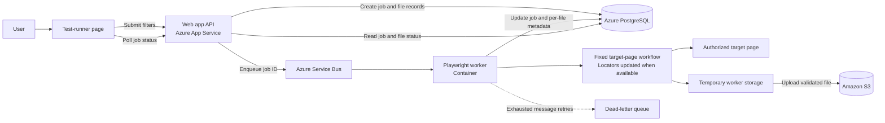
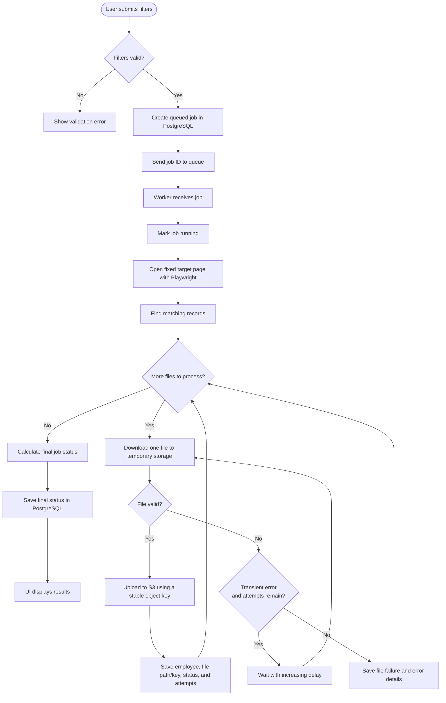

# Extractor Util — Solution Design

These diagrams describe the proposed extended system. The S3, PostgreSQL, and queue integrations are future extensions, not current implementations.

## Solution design

## Automation and retry flow

